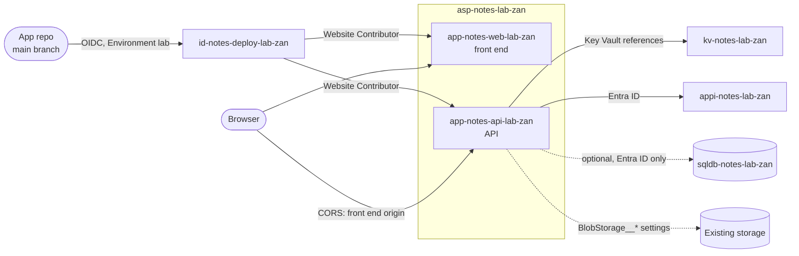

# terraform-azurerm-web-app

[](https://github.com/goosain-platform-lab/terraform-azurerm-web-app/actions/workflows/ci.yml)

Terraform module for a **two-tier Azure web app**: a front end and an API on one Linux App Service plan, with the API's secrets in Key Vault and a deploy identity that only the app repository's `main` branch can use. A submodule creates that repository's GitHub Environment. See [`examples/two-tier`](examples/two-tier).

| | |
|---|---|
| **Code owners** | `@goosain-platform-lab/platform-owners`, in [`.github/CODEOWNERS`](.github/CODEOWNERS). A platform owner approves every change |
| **CI** | `terraform fmt`, `validate` (root, `examples/*`, `modules/*`), tflint, `terraform test` (mocked providers) and Checkov: [`.github/workflows/ci.yml`](.github/workflows/ci.yml) |

## What this demonstrates

- **No secrets in Terraform, GitHub or app settings:**
  - the API reads secrets as **Key Vault references** (`@Microsoft.KeyVault(...)`), resolved by App Service with the API's own identity;
  - secret values are set in the vault by the people in `key_vault_secrets_officer_principal_ids`, so they never reach Terraform state;
  - Application Insights takes telemetry from the API's identity only (local authentication off);
  - the optional Azure SQL database accepts Entra ID sign-in only, and the API connects without a password.
- **Deployments need an identity, not a password:** FTP and Kudu/Web Deploy basic authentication are off on both sites, so a publish profile can't deploy. GitHub Actions signs in with OIDC as the deploy identity.
- **Least privilege per app:**
  - the deploy identity holds **Website Contributor on its two sites only**: no Key Vault, no SQL, no other site;
  - the API's identity reads only this app's vault (one vault per app and environment), and the front end has no identity at all.
- **Only `main` deploys:** the deploy identity trusts one subject, `repo:<owner>/<repo>:environment:lab`, and the `lab` Environment accepts only `main`, with no admin bypass. Another branch, a tag or another repository gets no token Azure accepts.
- **Settings that work in .NET:** nested keys use `__` (`BlobStorage__PathPrefix` is `BlobStorage:PathPrefix` to ASP.NET Core). Variable validation rejects the near-misses (`BlobStorage_PathPrefix`, `:` in a name) before they reach Azure.
- **Tested without a cloud account:** `terraform test` against mocked providers checks the security defaults, names, settings, role scopes and validation rules on every pull request.

**Status:** validated in CI; not deployed, to avoid running costs.

## Architecture



| Identity | Used by | Permissions |
|---|---|---|
| `id-<workload>-deploy-*` | The app repository's deploy workflow, from the `lab` Environment (federated credential) | Website Contributor on the front end and the API |
| API (system-assigned) | The API at run time | Key Vault Secrets User on this app's vault; Monitoring Metrics Publisher on Application Insights; a database user you create (with `sql`); storage access you grant (with `api_blob_storage`) |
| Front end | Nothing | None: it serves static files |
| Your secrets officers | People | Key Vault Secrets Officer on this app's vault |

Names follow `<type>-<workload>-<environment>-<region>`, with a role token where there are two of a kind. With workload `notes`: `asp-notes-lab-zan`, `app-notes-web-lab-zan`, `app-notes-api-lab-zan`, `kv-notes-lab-zan`, `appi-notes-lab-zan`, `id-notes-deploy-lab-zan`, and with `sql`, `sql-notes-lab-zan` and `sqldb-notes-lab-zan`.

## Usage

```hcl
module "web_app" {
  source = "github.com/goosain-platform-lab/terraform-azurerm-web-app"

  workload                   = "notes"
  location                   = "southafricanorth"
  resource_group_name        = "rg-notes-lab-zan"
  log_analytics_workspace_id = azurerm_log_analytics_workspace.this.id

  api_app_settings      = { "Features__Notes" = "true" }
  api_key_vault_secrets = { "Payments__ApiKey" = "payments-api-key" }

  key_vault_secrets_officer_principal_ids = ["<group object id>"]

  deploy = {
    github_repository = "goosain-platform-lab/notes-app"
  }
}

module "github_environment" {
  source = "github.com/goosain-platform-lab/terraform-azurerm-web-app//modules/github-deploy-environment"

  repository            = "notes-app"
  environment           = module.web_app.deploy_environment
  environment_variables = module.web_app.deployment_variables
}
```

## The deploy workflow (in the app repository)

The Environment gives the workflow `AZURE_CLIENT_ID`, `AZURE_TENANT_ID`, `AZURE_SUBSCRIPTION_ID`, `WEB_APP_NAME` and `API_APP_NAME` as variables. There are no deployment secrets.

```yaml
jobs:
  deploy:
    runs-on: ubuntu-latest
    environment: lab            # only main can use it
    permissions:
      id-token: write           # the OIDC token Azure exchanges
      contents: read
    steps:
      # Pin every action to a full commit SHA, as the org requires.
      - uses: azure/login@<sha>
        with:
          client-id: ${{ vars.AZURE_CLIENT_ID }}
          tenant-id: ${{ vars.AZURE_TENANT_ID }}
          subscription-id: ${{ vars.AZURE_SUBSCRIPTION_ID }}
      - uses: azure/webapps-deploy@<sha>
        with:
          app-name: ${{ vars.API_APP_NAME }}
          package: api.zip
```

The org allows only listed third-party actions: add `azure/login@*` and `azure/webapps-deploy@*` to `actions_policy.patterns_allowed` in platform-iac-template before the first app deploys.

## Setup (if you deploy it)

1. Set up HCP Terraform with OIDC as in the [AKS module's bootstrap script](https://github.com/goosain-platform-lab/terraform-azurerm-aks/blob/main/scripts/bootstrap-azure.ps1). Terraform needs Contributor and Role Based Access Control Administrator on the subscription. Constrain the second one with a condition to the roles this module assigns: Website Contributor, Key Vault Secrets User, Key Vault Secrets Officer, Monitoring Metrics Publisher.
2. Give the GitHub provider a GitHub App installation with **Administration** and **Variables** (read and write) on the app repository only.
3. Create HCP workspace `notes-lab` with working directory `examples/two-tier` and `app_repository = "<repo>"`. Plan and apply.
4. Add each secret named in `api_key_vault_secrets`, as a secrets officer, then restart the API so it resolves the references:
   ```powershell
   az keyvault secret set --vault-name kv-notes-lab-zan -n payments-api-key --value '<value>'
   az webapp restart -g rg-notes-lab-zan -n app-notes-api-lab-zan
   ```
5. With `sql`: as the Entra admin, create the API's database user once:
   ```sql
   CREATE USER [app-notes-api-lab-zan] FROM EXTERNAL PROVIDER;
   ALTER ROLE db_datareader ADD MEMBER [app-notes-api-lab-zan];
   ALTER ROLE db_datawriter ADD MEMBER [app-notes-api-lab-zan];
   ```
6. With `api_blob_storage`: grant the API's identity (`api_app.principal_id`) its data access yourself. Azure checks RBAC before folder ACLs, so a container- or account-level data role overrides any folder ACL. For access to one folder only, use ACLs and no data role.

Without `app_subnet_id`, App Service reaches Key Vault and SQL over their public endpoints: the vault accepts public traffic and SQL allows Azure services, and both rely on Entra ID alone. With a subnet (delegated to `Microsoft.Web/serverFarms`, with the `Microsoft.KeyVault` and `Microsoft.Sql` service endpoints), both sites route all traffic through it, the vault firewall denies everything but that subnet and `key_vault_allowed_ip_ranges`, and SQL lets in only that subnet.

## Cost

One B1 plan, Application Insights and a Basic SQL database (if enabled) run continuously. Run `terraform destroy` after a session. Purge protection is off by default so the vault name can be reused straight after a destroy; turn it on for anything long-lived.

## Module reference

**Required inputs:** `workload`, `location`, `resource_group_name`, `log_analytics_workspace_id`, `deploy.github_repository`.

**Optional inputs:**
- Naming: `environment` (default `lab`), `unique_suffix`, `tags`.
- Hosting: `app_service_plan_sku` (default `B1`), `web_stack` (default Node 22 serving static files with pm2), `api_stack` (default .NET 10), `api_health_check_path`, `api_cors_allowed_origins`, `app_subnet_id`.
- Settings: `web_app_settings`, `api_app_settings`, `api_key_vault_secrets`, `api_blob_storage`.
- Key Vault: `key_vault_secrets_officer_principal_ids`, `key_vault_allowed_ip_ranges`, `key_vault_purge_protection_enabled`.
- Database: `sql` (`entra_admin_login`, `entra_admin_object_id`, `sku_name`, `max_size_gb`).
- Deployment: `deploy.environment` (default: `environment`), `deploy.oidc_subject` (only if your org customised its OIDC subject template).

**Outputs:** `web_app`, `api_app`, `key_vault`, `deploy_identity`, `deployment_variables`, `deploy_environment`, `sql`, `names`.

**Submodule:** [`modules/github-deploy-environment`](modules/github-deploy-environment): the app repository's Environment, its allowed branches, optional reviewers and its variables.
